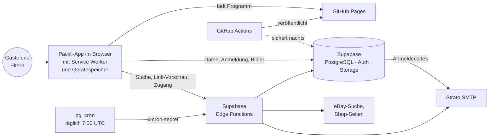
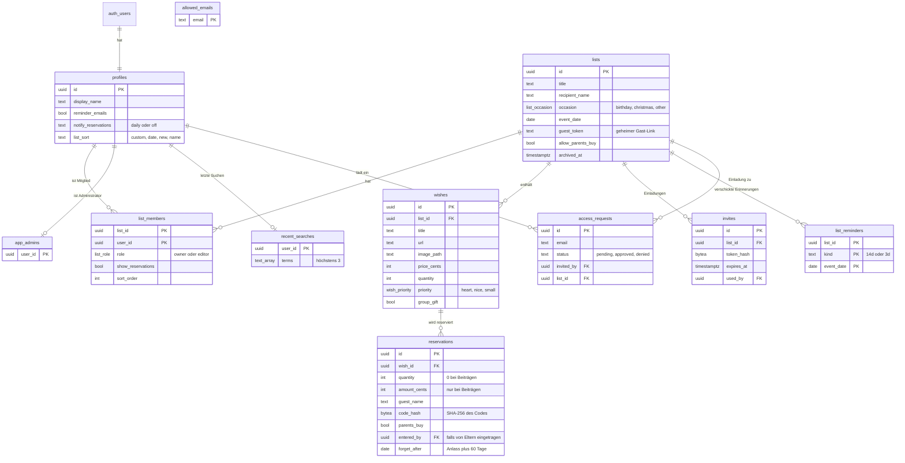
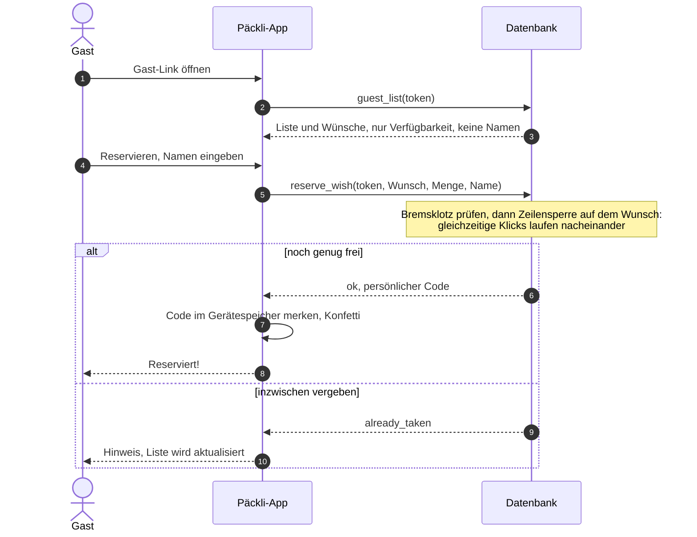
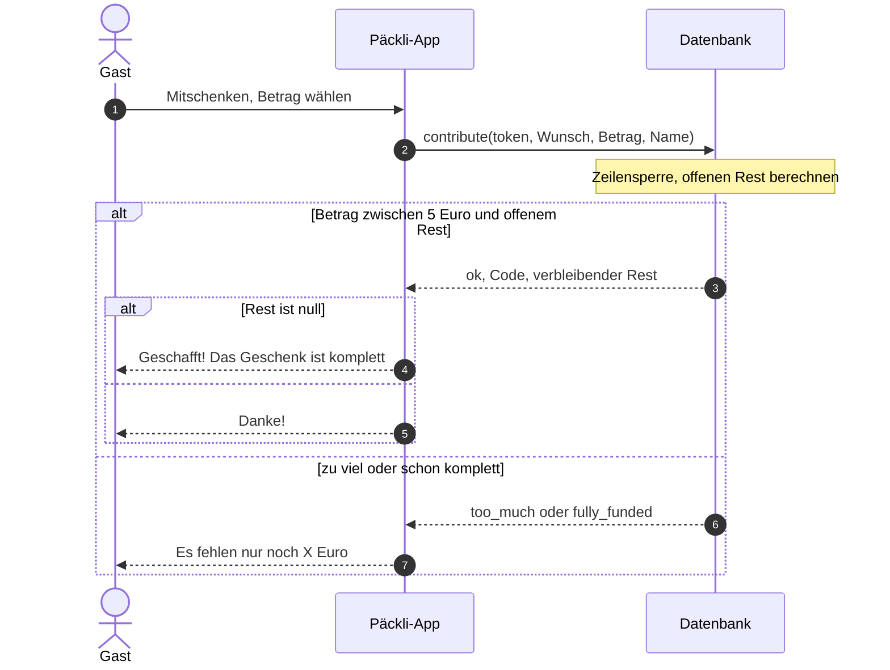
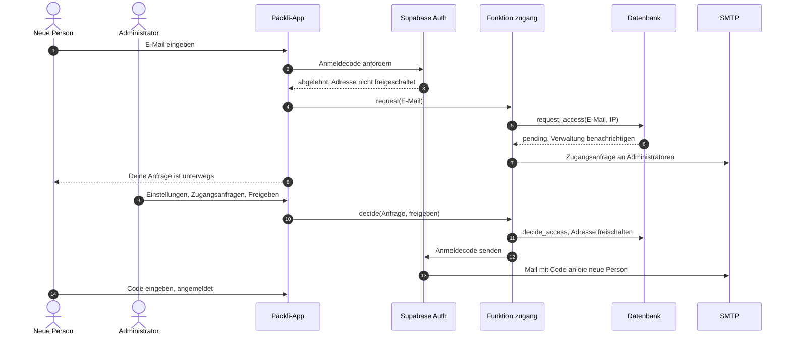
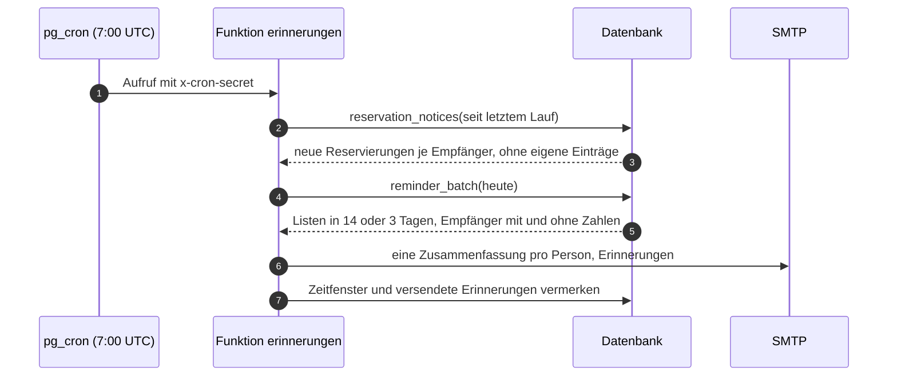
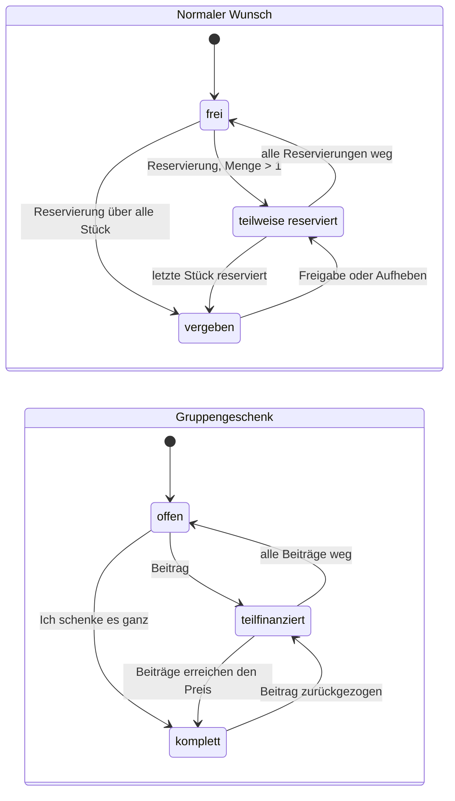
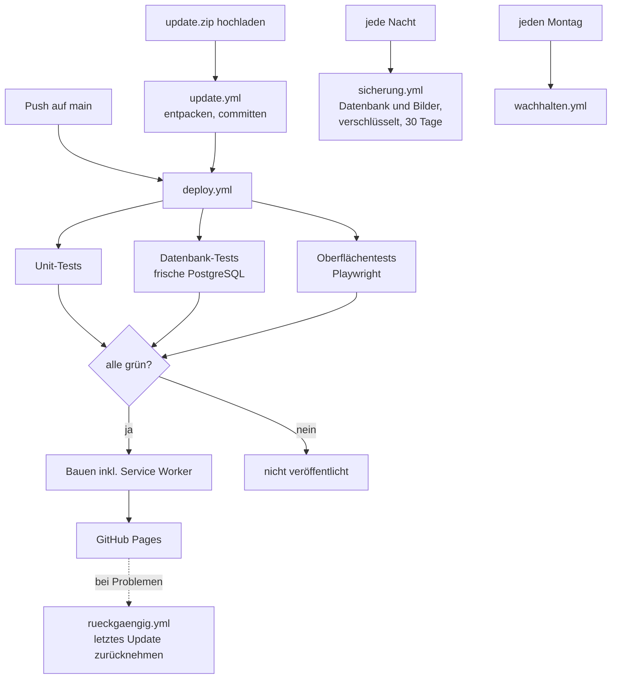

# Päckli – Spezifikation

Stand: November 2026. Dieses Dokument beschreibt, **was** Päckli tut und **warum**. Wie man es einrichtet
und betreibt, steht im [README](README.md).

## Inhalt
1. [Zweck und Grundsätze](#1-zweck-und-grundsätze)
2. [Begriffe](#2-begriffe)
3. [Rollen und Rechte](#3-rollen-und-rechte)
4. [Architektur](#4-architektur)
5. [Funktionale Anforderungen](#5-funktionale-anforderungen)
6. [Datenmodell](#6-datenmodell)
7. [Abläufe](#7-abläufe)
8. [Zustände eines Wunsches](#8-zustände-eines-wunsches)
9. [Schnittstellen](#9-schnittstellen)
10. [Nicht-funktionale Anforderungen](#10-nicht-funktionale-anforderungen)
11. [Auslieferung und Betrieb](#11-auslieferung-und-betrieb)
12. [Teststrategie](#12-teststrategie)
13. [Bewusst nicht enthalten](#13-bewusst-nicht-enthalten)

---

## 1. Zweck und Grundsätze

Päckli hilft Familien, Geschenkwünsche zu sammeln und doppelte Geschenke zu vermeiden.

| Grundsatz | Bedeutung |
|---|---|
| **Gäste brauchen nichts** | Kein Konto, keine App, kein Passwort. Ein Link genügt, auch für Großeltern. |
| **Überraschung schützen** | Wer eine Liste für sich selbst führt, kann Reservierungen für sich ausblenden. Gäste sehen nie, wer was schenkt. |
| **Kein Doppelschenken** | Reservierungen sind verbindlich und gegen gleichzeitige Klicks abgesichert. |
| **Geschlossener Kreis** | Nur freigeschaltete Personen bekommen ein Konto; neue Bearbeiter gibt ein Administrator frei. |
| **Datensparsam** | Von Gästen nur der Name; alte Reservierungen werden automatisch gelöscht. |
| **Einfach vor vollständig** | Lieber eine klare Funktion als drei halbe; seltene Optionen sind eingeklappt. |

## 2. Begriffe

| Begriff | Bedeutung |
|---|---|
| **Liste** | Wunschliste für einen Anlass (Geburtstag, Weihnachten, Sonstiges) mit Datum und beschenkter Person |
| **Wunsch** | Ein Eintrag auf der Liste mit Name, optional Link, Shop, Bild, Preis, Menge, Priorität und Notiz |
| **Priorität** | Herzenswunsch, Wäre schön, Kleine Aufmerksamkeit |
| **Reservierung** | Zusage eines Gastes, einen Wunsch (oder eine Stückzahl davon) zu schenken |
| **Gruppengeschenk** | Wunsch, zu dem mehrere Gäste Beträge beisteuern; vergeben, sobald der Preis erreicht ist |
| **Beitrag** | Reservierung mit Betrag statt Stückzahl (bei Gruppengeschenken) |
| **Gast-Link** | Geheimer Link zur Gästeansicht einer Liste; kann erneuert werden |
| **Reservierungscode** | Persönlicher Code eines Gastes (z. B. `K7PM-Q3XA`), mit dem er seine Reservierung aufheben kann |
| **„Bitte besorgt ihr es“** | Gast bittet die Eltern, das Geschenk zu kaufen, und gibt ihnen das Geld (nur wenn die Liste es erlaubt) |
| **Abgeschlossen** | Archivierte Liste; der Gast-Link ist pausiert |

## 3. Rollen und Rechte

| Aktion | Besitzer | Mitbearbeiter | Gast | Administrator |
|---|:-:|:-:|:-:|:-:|
| Liste und Wünsche ansehen | ✓ | ✓ | ✓ ohne Namen | – |
| Reservieren, mitschenken, eigene Reservierung aufheben | ✓ | ✓ | ✓ | – |
| Wünsche anlegen, bearbeiten, löschen, verschieben | ✓ | ✓ | – | – |
| Liste bearbeiten, abschließen, wiederverwenden | ✓ | ✓ | – | – |
| Sehen, wer was reserviert hat (eigener Schalter) | ✓ | ✓ | – | – |
| Für jemanden reservieren oder Beitrag eintragen, freigeben | ✓ | ✓ | – | – |
| Mitbearbeiter einladen und entfernen | ✓ | – | – | – |
| Gast-Link erneuern, Liste löschen | ✓ | – | – | – |
| Liste verlassen | – | ✓ | – | – |
| Neue Bearbeiter freigeben oder ablehnen | – | – | – | ✓ |

Administrator ist eine zusätzliche Rolle eines Kontos (Tabelle `app_admins`), unabhängig von einzelnen Listen.
Lädt ein Administrator jemanden ein, ist die Person sofort freigeschaltet; bei allen anderen entsteht eine Anfrage.

Alle Rechte werden **in der Datenbank** durchgesetzt (Row Level Security und Prüfungen in den Funktionen),
nicht nur in der Oberfläche.

## 4. Architektur

**Aufgabenteilung:** Die App ist eine reine Browser-Anwendung ohne eigenen Server. Alle Regeln liegen in der
Datenbank. Edge Functions übernehmen nur, was der Browser nicht darf: geheime Schlüssel (eBay, SMTP),
Abrufen fremder Seiten und Mails.

## 5. Funktionale Anforderungen

### 5.1 Anmeldung und Zugang
- **F-1** Anmeldung per E-Mail mit Einmal-Code oder Link, ohne Passwort. Der Code funktioniert auch in der installierten App.
- **F-2** Konten nur für freigeschaltete Adressen (`allowed_emails`).
- **F-3** Unbekannte Adressen erhalten statt einer Fehlermeldung eine **Zugangsanfrage**; Administratoren werden per Mail benachrichtigt.
- **F-4** Erst nach Freigabe durch einen Administrator wird die Mail mit dem Anmeldecode verschickt. Abgelehnte Adressen lösen 30 Tage keine neue Benachrichtigung aus.

### 5.2 Listen
- **F-10** Mehrere Listen pro Konto mit Titel, beschenkter Person, Anlass, Datum, Beschreibung und Symbol.
- **F-11** Einstellung pro Liste: „Wir besorgen Geschenke auf Wunsch“ (erlaubt Gästen „Bitte besorgt ihr es“).
- **F-12** Übersicht mit Fortschritt und Countdown; sortierbar (eigene Reihenfolge, nächster Anlass, neueste, Name). Die eigene Reihenfolge gilt pro Person und wird durch Gedrückthalten und Ziehen geändert.
- **F-13** Abschließen (Gast-Link pausiert) und Wiederverwenden (neue Liste mit den noch freien Wünschen).
- **F-14** Eine leere Liste führt zum ersten Wunsch statt zum Teilen.

### 5.3 Wünsche
- **F-20** Hinzufügen in zwei Schritten: (1) Produktsuche mit bis zu 25 Treffern, Link einfügen oder selbst eintragen; (2) Details.
- **F-21** Link-Auswertung: Name, Bild, Preis und Shop werden, soweit der Shop es zulässt, automatisch übernommen.
- **F-22** Teilen aus anderen Apps (Android direkt, iPhone über einen Kurzbefehl) öffnet Schritt 1 mit dem Link.
- **F-23** Priorität, Menge (1–20), Notiz, eigenes Foto (verkleinert), Gruppengeschenk (nur mit Preis).
- **F-24** Verschieben und Kopieren zwischen eigenen Listen; reservierte Wünsche lassen sich nur kopieren.
- **F-25** Löschen ohne Rückfrage mit „Rückgängig“; Rückfrage nur, wenn eine fremde Reservierung betroffen sein kann.
- **F-26** Die letzten drei Suchbegriffe pro Person, einzeln entfernbar.

### 5.4 Gästeansicht
- **F-30** Erreichbar über den Gast-Link ohne Konto; Kacheln oder Liste, Preisfilter.
- **F-31** Kacheln mit festem Aufbau (gleich hoch, Knöpfe auf einer Linie); ein Tipp zeigt alle Details.
- **F-32** Reservieren mit Pflichtnamen und optional Stückzahl; „Bitte besorgt ihr es“, wenn die Liste es erlaubt.
- **F-33** Gruppengeschenke: Summe und Anzahl der Beitragenden sichtbar, nie Namen oder Einzelbeträge. Beiträge ab 5 €, höchstens der offene Rest; „Ich schenke es ganz“, solange niemand beigetragen hat.
- **F-34** Das Gerät merkt sich die eigenen Reservierungscodes; Aufheben auf demselben Gerät.
- **F-35** Erklärung beim ersten Besuch, danach eingeklappt.

### 5.5 Reservierungen aus Elternsicht
- **F-40** Pro Person schaltbar: Reservierungen anzeigen oder ausblenden (Überraschungsschutz).
- **F-41** Für jemanden reservieren bzw. einen Beitrag eintragen (z. B. nach einem Anruf); „Rest selbst übernehmen“.
- **F-42** Freigeben mit „Rückgängig“.

### 5.6 Mitglieder und Zugriff
- **F-50** Einladen per Link (einmalig, 7 Tage gültig) und Freischalten der Adresse.
- **F-51** Zugriffsverwaltung: pro Person die eigenen Listen ein- und ausschalten; Übersicht „Wer darf was?“.

### 5.7 Benachrichtigungen
- **F-60** Erinnerungs-Mails 14 und 3 Tage vor dem Anlass mit Stand; ohne Zahlen für Personen mit ausgeblendeten Reservierungen.
- **F-61** Tägliche Zusammenfassung neuer Reservierungen (nur wenn es Neues gibt), abbestellbar.

### 5.8 Statistik
- **F-70** Auswahl „Alle Listen“ oder einzelne Liste; Stand, Herzenswünsche, Geldwerte, Schenkende, Zeitverlauf, Rückblick pro beschenkter Person.
- **F-71** Von der Liste aus direkt erreichbar (Tipp auf den Stand).

### 5.9 Allgemein
- **F-80** Nach unten ziehen zum Aktualisieren; automatisches Aktualisieren bei Rückkehr in die App.
- **F-81** Offline: Start ohne Netz mit dem zuletzt geladenen Stand; Hinweis „Offline“.
- **F-82** Kleine Freudenmomente (Konfetti) beim Reservieren, bei komplettem Gruppengeschenk und bei komplett vergebener Liste; nicht bei „Bewegung reduzieren“.
- **F-83** Heller und dunkler Modus nach Geräteeinstellung.

## 6. Datenmodell

**Hilfstabellen ohne Bezug zu Personen:** `rate_events` (Bremsklotz), `client_errors` (anonymes Fehlerprotokoll,
30 Tage), `notify_state` (Zeitfenster der täglichen Mail).

**Wichtige Regeln in der Datenbank**
- Die Menge eines Wunsches kann nicht unter die reservierte Stückzahl sinken.
- Reservierte Wünsche können nicht in eine andere Liste verschoben werden.
- Gruppengeschenke brauchen einen Preis; die Einstellung lässt sich nicht ändern, solange es Beiträge gibt.
- Ein Konto kann nur für eine freigeschaltete Adresse entstehen (Trigger auf `auth.users`).

## 7. Abläufe

### 7.1 Gast reserviert

### 7.2 Gruppengeschenk: Beitrag

### 7.3 Neue Bearbeiter: Anfrage und Freigabe

Lädt ein **Administrator** selbst ein, wird die Adresse sofort freigeschaltet: Es entsteht keine Anfrage,
und die eingeladene Person kann sich direkt mit Code anmelden. Lädt jemand anderes ein, entsteht dieselbe Anfrage
wie in Schritt 5, nur mit Name der einladenden Person und der Liste.

### 7.4 Tägliche Mails

## 8. Zustände eines Wunsches

„Vergeben“ und „komplett“ zählen in Übersicht, Statistik und Erinnerungen als vergeben; Gäste sehen den Wunsch dann im
Bereich „Schon vergeben“.

## 9. Schnittstellen

### 9.1 Datenbank-Funktionen

| Funktion | Aufrufer | Zweck |
|---|---|---|
| `guest_list(token)` | Gast | Liste für die Gästeansicht, ohne Namen |
| `reserve_wish(token, wunsch, menge, name, eltern_besorgen)` | Gast | Reservieren (mit Zeilensperre und Bremsklotz) |
| `contribute(token, wunsch, betrag, name)` | Gast | Beitrag zu einem Gruppengeschenk |
| `cancel_reservation(code)` | Gast | Eigene Reservierung aufheben |
| `my_reservations(codes)` | Gast | Eigene Reservierungen anhand der Codes auf dem Gerät |
| `log_client_error(…)` | alle | Anonymes Fehlerprotokoll |
| `create_list(…)`, `create_invite`, `accept_invite`, `rotate_guest_link` | Eltern | Listen und Einladungen |
| `reserve_for_guest`, `contribute_for_guest` | Eltern | Für jemanden reservieren bzw. Beitrag eintragen |
| `set_show_reservations`, `set_list_order`, `add_member` | Eltern | Persönliche Einstellungen, Zugriff |
| `allow_email(email, liste)` | Eltern | Einladen: Admin schaltet frei, sonst Anfrage |
| `pending_access_requests`, `decide_access` | Administrator | Zugangsanfragen |
| `request_access`, `reminder_batch`, `reservation_notices`, … | nur Server | von den Edge Functions mit dem Service-Schlüssel |

Alle übrigen Lese- und Schreibzugriffe laufen direkt über die Tabellen, geschützt durch Row Level Security.

### 9.2 Edge Functions

| Funktion | Auslöser | Prüfung | Aufgabe |
|---|---|---|---|
| `link-vorschau` | App (angemeldet) | Anmeldung | Name, Bild, Preis aus einer Shop-Seite lesen (ohne interne Adressen) |
| `produkt-suche` | App (angemeldet) | Anmeldung | eBay-Suche, Neuware, bis zu 50 Treffer |
| `erinnerungen` | pg_cron | `x-cron-secret` | Erinnerungen und tägliche Zusammenfassung |
| `zugang` | App | Anmeldung bzw. Bremsklotz | Zugangsanfragen, Einladen, Freigeben samt Code-Mail |

## 10. Nicht-funktionale Anforderungen

| Bereich | Anforderung | Umsetzung |
|---|---|---|
| **Sicherheit** | Rechte serverseitig durchsetzen | Row Level Security auf allen Tabellen; Gäste nur über Funktionen; Funktionsrechte zusätzlich eingeschränkt |
| | Geheimnisse schützen | Codes und Einladungen als SHA-256; Schlüssel nur in Edge-Function-Secrets |
| | Missbrauch bremsen | 10 Reservierungen pro Liste und Minute, 20 falsche Codes in 10 Minuten, 30 Abfragen pro Minute, 5 Anfragen in 10 Minuten |
| | Fremden Code verhindern | Content-Security-Policy: Skripte nur von Päckli, Verbindungen nur zu Supabase |
| **Datenschutz** | Minimale Daten | Gäste: nur Name; Reservierungen 60 Tage nach dem Anlass gelöscht; Fehlerprotokoll anonym, 30 Tage |
| | Keine Dritten beim Öffnen | Schriften lokal; keine Analyse- oder Werbedienste |
| **Geschwindigkeit** | Schnelle Bedienung | Wichtige Programmteile und Schriften werden parallel vorgeladen; Listen im Leerlauf vorgeladen; Liste erscheint in unter 1 s auch bei langsamer Datenbank (Test) |
| **Offline** | Start ohne Netz | Service Worker für die App-Hülle, zuletzt geladene Daten im Gerätespeicher; Startseite immer zuerst aus dem Netz, damit Updates sofort ankommen |
| **Robustheit** | Netzaussetzer | Leseanfragen werden wiederholt, schreibende nicht (keine Doppelbuchungen); Absturzschutz mit „Neu laden“ |
| **Barrierefreiheit** | Lesbar und bedienbar | Kontrast mindestens 4,5:1 in hell und dunkel (gemessen); Tippflächen ab 44 px; Tastaturbedienung inkl. Verschieben; Rücksicht auf „Bewegung reduzieren“ |
| **Geräte** | Handy zuerst | Getestet auf 320, 360 und 390 px Breite; kein seitliches Scrollen |

## 11. Auslieferung und Betrieb

Datenbank-Änderungen werden als nummerierte SQL-Dateien geliefert (`supabase/02_…` bis `18_…`) und einmalig im
SQL Editor ausgeführt; `schema.sql` enthält immer den vollständigen Stand für neue Projekte.

## 12. Teststrategie

| Ebene | Werkzeug | Umfang |
|---|---|---|
| Logik | Vitest | Preise, Link-Erkennung, Statistik, Sortieren, Countdown, Schwärzen im Fehlerprotokoll |
| Datenbank | SQL gegen frische PostgreSQL | Zugriffsschutz, Doppelbuchung (auch gleichzeitig), Gruppengeschenke, Bremsklotz, Benachrichtigungen, Freigaben, Funktionsrechte |
| Oberfläche | Playwright im Handyformat | alle Hauptabläufe für Gäste und Eltern, Touch-Gesten, Offline mit echtem Service Worker, Geschwindigkeit, CSP-Verstöße |
| Mails und Funktionen | lokal mit nachgebauter Datenbank und Mailserver | Erinnerungen, Zusammenfassung, Zugangsanfragen |
| Sicherung | Kreislauf | sichern → verschlüsseln → entschlüsseln → in leere Datenbank zurückspielen → vollständig identisch |

Wichtige Tests wurden mit **Gegenproben** abgesichert: Mit absichtlich eingebautem Fehler müssen sie anschlagen.

## 13. Bewusst nicht enthalten

- **Bezahlen in der App:** Geld regelt die Familie direkt; Päckli koordiniert nur.
- **Konten für Gäste:** würde dem Grundsatz „Gäste brauchen nichts“ widersprechen.
- **Sofort-Benachrichtigungen:** zugunsten der täglichen Zusammenfassung weggelassen.
- **Amazon-Produktsuche, Preisalarm, Strichcode-Scan:** zu aufwendig oder nicht verlässlich verfügbar.

Weitere zurückgestellte Ideen stehen im [BACKLOG](BACKLOG.md).
